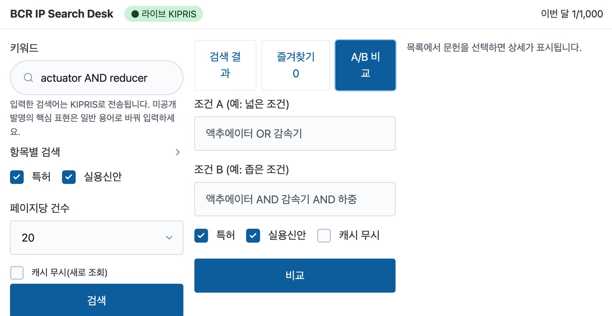

# BCR IP Search Desk



KIPRIS Plus Open API를 연결한 **로컬 실행형 특허·실용신안 검색 데스크**. KOITA「GPT x Claude 특허 리서치 자동화 입문」 M2(IP Search Desk)·M3(KIPRIS 연결과 데이터 정리) 미션용으로, 기술명세서 v1.0(2026-10-16)을 Claude Code로 구현했다. 키 없이도 샘플 모드로 같은 흐름을 쓸 수 있다.

## 주요 기능

| 구분 | 내용 |
|---|---|
| 검색 | 키워드(KIPRIS 연산자 그대로 전달), 항목별(명칭·출원인·IPC·출원일), 특허/실용신안 선택, 페이지네이션 |
| 결과 | 목록·상세·결과 내 필터(상태·출원연도·출원인), 건수·조회 시각·출처·캐시 여부 항상 표시 |
| 정리 | 즐겨찾기+메모, 출원번호 정규화 기반 중복 제거, A/B 조건 비교(공통·A만·B만), 검색 이력과 재검색 |
| 내보내기 | UTF-8 BOM CSV (조회조건·조회시각·출처 열, 엑셀 수식 주입 방지) |
| 안전장치 | 키는 `.env`에만 저장, `127.0.0.1`에만 바인딩, 로그의 `ServiceKey` 마스킹, XML은 `defusedxml`, 응답 캐시 24h, 월 사용량 80% 경고·100% 차단, 초당 5건 제한 |
| 오류 표시 | 인증·통신·한도 오류를 "0건"으로 위장하지 않고 배너로 구분 표시 |

## 실행 (3단계)

```bash
# 1) uv 설치 (최초 1회)
#    macOS:   curl -LsSf https://astral.sh/uv/install.sh | sh
#    Windows: powershell -c "irm https://astral.sh/uv/install.ps1 | iex"

# 2) 설정 파일 준비 (Windows: copy .env.example .env)
cp .env.example .env

# 3) 실행 → http://127.0.0.1:8000 이 자동으로 열린다
uv run ip-desk
```

- **라이브 모드:** `.env`에서 `IPDESK_MODE=kipris`, `KIPRIS_API_KEY=발급키`로 바꾼다(따옴표 없이). 키는 화면에서 입력하지 않는다.
- **키 확인:** `uv run ip-desk check` (1건 검색). 응답 원문(키 마스킹)까지 보려면 `--raw`. 이 호출도 월 사용량에 1건으로 집계된다.
- **테스트:** `uv run pytest` / **린트:** `uv run ruff check .`

> 입력한 검색어는 KIPRIS로 전송된다. 미공개 발명의 핵심 표현은 일반 용어로 바꿔 입력할 것.

## 빌드 과정 (명세 19장 4단계)

단계마다 실행·테스트로 확인한 뒤 다음으로 넘어갔다.

### 1단계 — 골격
- `uv` 기반 FastAPI 프로젝트: `pyproject.toml`, `.env.example`, `.gitignore`, 실행 스크립트 `ip-desk`
- `config.py`(pydantic-settings): kipris 모드에서 키가 없으면 안내 메시지를 내고 종료
- htmx·Alpine.js·Pico.css를 `web/static/`에 내려받아 CDN 없이 동작
- 확인: `uv run ip-desk`로 127.0.0.1:8000에서 "Hello IP Desk" 응답

### 2단계 — 샘플 모드 (M2)
- 도메인 모델·`PatentSource` 포트·`SampleAdapter`, 가상 문헌 25건(`data/sample/patents_a200.json`, 출원번호 표기를 일부러 섞음)
- SQLite 스키마(`001_init.sql`)와 저장소, 검색 이력·즐겨찾기 저장
- 서비스 계층과 JSON API(`/api/*`), htmx 화면(`/ui/*`): 검색·결과·상세·즐겨찾기·이력
- 2쪽 이후 요청은 직전 실행에 이어 붙여 이력이 쪽마다 늘어나지 않게 함
- 확인: 샘플 검색·상세·즐겨찾기, 서버 재시작 후 즐겨찾기와 메모 유지

### 3단계 — KIPRIS 연결 (M3)
- `KiprisAdapter`: 오류 판정 8단계(통신 → 5xx → XML 파싱 → 인증 → 한도 → 기타 코드 → 0건 → 정상), HTTP 200이어도 `resultCode` 확인
- 5xx·타임아웃은 지수 백오프로 최대 2회 재시도, 인증 오류는 재시도하지 않음
- `ServiceKey`는 발급 그대로 전달(이중 인코딩 방지), 로그·오류 문구에서는 `***`로 마스킹
- 외부 필드명은 `kipris.py`의 `PARAM_MAP`/`FIELD_MAP`/`ITEM_PATHS`, 코드는 `kipris_codes.py`에만 둠
- 픽스처 XML(정상·0건·인증오류·깨진 XML·상세·XXE 시도)과 respx 테스트, `ip-desk check [--raw]`

### 4단계 — 정리 기능
- 응답 캐시(조건 SHA-256, TTL 24h, 오류는 저장 안 함), 월 사용량 카운터, 토큰 버킷 속도 제한. 재시도도 호출 수에 포함
- 출원번호 정규화(`10-2024-0001234` ↔ `1020240001234`)와 `dedup_records`, A/B 비교(조건당 최대 200건)
- 결과 내 필터(Alpine.js, 현재 쪽 기준)
- CSV 내보내기: 즐겨찾기 또는 검색 결과, `exports/`에도 사본 저장
- 확인: 아래 수용 기준 표

### 이후 — 실제 환경 확인과 배포
- `.env`에 발급받은 키를 입력하고 `IPDESK_MODE=kipris`로 실행해 라이브 검색 결과를 확인했다.
- 이 저장소에 푸시했다. `.env`·`data/*.db`·`exports/`·`.DS_Store`는 추적하지 않는다.

## 수용 기준 점검 (명세 17장)

| 항목 | 상태 | 근거 |
|---|---|---|
| 샘플 모드 키워드 검색·목록·상세 | 통과 | 브라우저 확인 + `test_sample_flow.py` |
| 즐겨찾기가 앱 재실행 후에도 유지 | 통과 | 서버 재시작 후 확인 + 테스트 |
| 결과 헤더에 건수·조회 시각·출처 | 통과 | 화면 확인 |
| 라이브 모드에서 실제 KIPRIS 결과 표시 | 통과 | 사용자가 실제 키로 검색 결과 확인 |
| 잘못된 키는 "0건"이 아니라 인증 오류 배너 | 부분 | 가짜 응답(픽스처)로만 검증. 실제 KIPRIS의 인증 오류 응답은 확인 못 함 |
| 결과 없는 조건은 오류가 아니라 0건 안내 | 통과 | 테스트 |
| 같은 출원번호가 한 줄로 병합 | 통과 | `test_dedup.py` (patents 한 줄, 출처는 `run_records`에 모두 기록) |
| CSV에 조회조건·시각·출처 열, 한글 안 깨짐 | 부분 | BOM·열·이스케이프 테스트 통과. 실제 엑셀로 열어 보지는 않음 |
| `git ls-files`에 `.env`와 키 문자열 없음 | 통과 | 푸시 전 추적 파일 전체에서 실제 키 값을 검색해 없음을 확인 |

## 구현 중 발견해 직접 고친 오류

| # | 문제 | 원인 | 조치 |
|---|---|---|---|
| 1 | uv가 Python 3.14로 가상환경을 만듦 | `requires-python = ">=3.12"`만 지정 | `.python-version`을 3.12로 고정 (명세는 3.12 기준) |
| 2 | 1단계 서버가 종료되지 않고 8000 포트를 계속 점유해 "Hello IP Desk"만 응답 | 종료 명령이 대상 프로세스를 못 잡음 | 프로세스를 직접 종료 후 재기동. 이후 검증 때마다 포트 점유를 확인 |
| 3 | 탭 버튼 글자가 흰 바탕에 흰색으로 보임 | Pico가 `button`에 지정한 색 변수가 내 CSS보다 우선 | 전용 선택자와 `--pico-primary` 색으로 수정 (2회에 걸쳐 확인) |
| 4 | Windows에서 `Asia/Seoul` 시간대를 못 찾을 수 있음 | 표준 `zoneinfo`는 OS 시간대 DB에 의존 | `tzdata`를 의존성에 추가 |
| 5 | 쪽을 넘길 때마다 검색 이력이 한 줄씩 늘어날 뻔함 | 요청마다 새 실행(run)을 기록하는 설계 | 쪽 번호·쪽당 건수를 뺀 조건 해시로 직전 실행에 이어 붙임 |
| 6 | 캐시 테스트가 실패 | 테스트가 `include_utility`를 빠뜨려 다른 조건이 됨 (앱 동작은 정상) | 테스트 입력을 고침 |
| 7 | `.DS_Store`가 커밋 대상에 포함됨 | `.gitignore`에 없었음 | 추적에서 제거하고 `.gitignore`에 추가 후 커밋 |
| 8 | 린트(E501) 오류와 테스트의 느슨한 단언·어색한 환경변수 처리 | 초안 코드 | 정리 후 `ruff` 통과 |

## 알려진 한계와 아직 확인하지 못한 것

- **KIPRIS 명세의 "예상" 값:** 엔드포인트·파라미터·필드명은 명세 9장 기준이다. 실제 검색은 동작하지만 모든 필드를 응답과 대조하지는 않았다. `resultCode`는 30·31만 명세 근거가 있고 22(한도)·32(IP)는 **추정값**이다.
- **⚙ 설정 화면(모드 전환)은 구현하지 않았다.** 모드는 `.env`에서 바꾼다.
- **Enter 키로 검색 제출:** 자동 도구로는 확인하지 못했다. 검색 버튼은 확인했다.
- **A/B 비교:** 조건당 최대 200건까지만 가져온다. 넘으면 공통·A만·B만은 하한값이며 화면에 경고가 뜬다.
- **결과 내 필터:** 현재 쪽에 불러온 결과에만 적용된다.
- **검색 결과 CSV:** 사용자가 조회한 쪽의 문헌만 포함한다.
- 최소 화면 폭은 1024px(명세 기준 데스크톱)이다.

## 구조

```
src/ipdesk/
├── main.py            # FastAPI 앱, ip-desk / ip-desk check
├── config.py          # Settings (.env)
├── context.py         # 의존성 조립 (소스·캐시·사용량·서비스)
├── domain/            # 모델·오류 (외부 필드명을 모름)
├── ports/             # PatentSource 인터페이스
├── adapters/          # kipris.py, kipris_codes.py, sample.py
├── services/          # search(캐시·A/B), favorites, export, usage, cache
├── repo/              # SQLite 마이그레이션·저장소
├── api/               # routes.py(JSON /api/*), pages.py(htmx /ui/*)
└── web/               # templates, static
```

데이터 소스는 `PatentSource` 포트 뒤에 있어 샘플과 라이브가 같은 서비스 계층을 쓴다. 이후 M4(LLM 요약)·M5(상표)·M6(IP Watch Agent)는 포트와 어댑터를 추가하는 방식으로 확장한다.

## 설정 (.env)

| 키 | 기본값 | 설명 |
|---|---|---|
| `IPDESK_MODE` | `sample` | `sample` 또는 `kipris` |
| `KIPRIS_API_KEY` | (빈 값) | KIPRIS Plus 발급 키 |
| `KIPRIS_BASE_URL` | `https://plus.kipris.or.kr/kipo-api/kipi` | |
| `KIPRIS_TIMEOUT_SEC` | `10` | 호출 타임아웃 |
| `KIPRIS_RATE_PER_SEC` | `5` | 앱 내부 초당 호출 제한 |
| `KIPRIS_MONTHLY_LIMIT` | `1000` | 월 한도(80% 경고, 100% 차단) |
| `CACHE_TTL_HOURS` | `24` | 응답 캐시 유효 시간 |
| `HOST` / `PORT` | `127.0.0.1` / `8000` | 바인딩 주소 |
| `DEBUG` | `false` | true면 마스킹된 원문을 `logs/raw/`에 저장 |

## 내부 REST API

`/docs`(FastAPI 자동 문서)에서 바로 시험할 수 있다.

| 메서드 | 경로 | 설명 |
|---|---|---|
| GET | `/api/health` | 모드, 키 설정 여부(값 미노출), 월 사용량 |
| POST | `/api/search` | 검색 (`refresh: true`면 캐시 무시) |
| GET | `/api/patents/{출원번호}` | 서지 상세 |
| POST | `/api/compare` | A/B 비교 (건수·공통·A만·B만) |
| GET | `/api/runs` | 검색 이력 |
| POST | `/api/runs/{id}/rerun` | 이력 재검색 (`?refresh=true`) |
| GET·PUT·DELETE | `/api/favorites[/{출원번호}]` | 즐겨찾기 |
| GET | `/api/export.csv?scope=favorites` 또는 `?run_id=` | CSV 다운로드 |

---

BCR, A200, Nordvik은 교육용 가상 시나리오이며, 샘플 데이터의 문헌은 실제 특허가 아니다.
